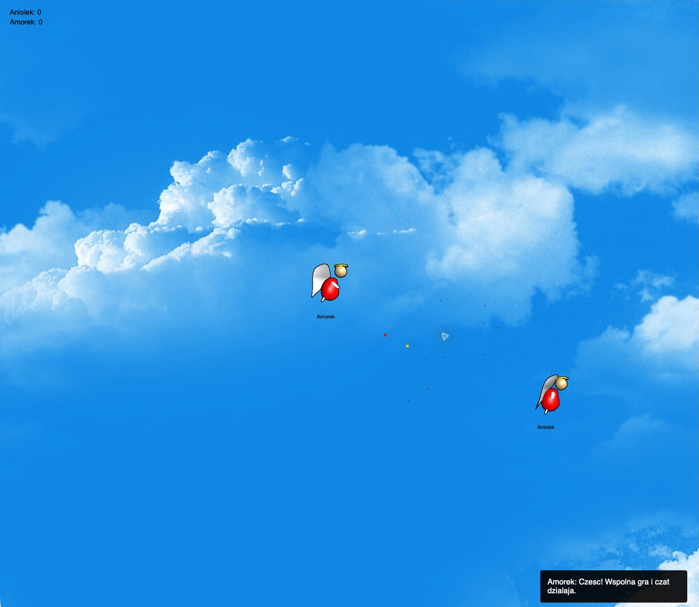

# Fat Angel Multiplayer 0.0.2

Przeglądarkowa gra multiplayer: latające anioły, strzelanie sercami i wspólny czat.
Serwer w Ruby utrzymuje jeden pokój; przeglądarka rysuje rozgrywkę na Canvas.

**Publiczna gra:** [fat-angel.onrender.com](https://fat-angel.onrender.com).
Ta dokumentacja opisuje branch **`0.0.2`**. Publiczna usługa korzysta z wcześniejszego
brancha `codex/ai-fun`; zmiany 0.0.2 wymagają osobnego wdrożenia.

## Zmiany w 0.0.2

- Niezależna symulacja **60 Hz** i wspólny stan wysyłany do klientów około **20 razy/s**.
  Odczyty stanu nie przyspieszają gry; JSON powstaje raz na aktualizację, wspólnie dla graczy.
- Canvas 2D z `requestAnimationFrame`, interpolacją pozycji, buforem obrazów,
  powtarzanym wzorem tła i pomijaniem obiektów poza ekranem.
- Formularz dołączania oraz panel czatu z bezpiecznym wyświetlaniem tekstu,
  walidacją po stronie serwera, potwierdzaniem nicka i limitami spamu.
- Limity połączeń, rozmiaru wiadomości, strzałów i resetów; sprawdzanie `Origin`,
  nagłówki bezpieczeństwa oraz rozłączanie bezczynnych lub zbyt wolnych klientów.

## Jak zacząć

1. Otwórz grę w przeglądarce z klawiaturą i myszą.
2. Wpisz nick mający **2–30 znaków** po usunięciu spacji z początku i końca.
3. Dołączysz do wspólnego pokoju, który mieści **do 25 graczy**.
4. Zaproś drugą osobę pod ten sam adres albo otwórz grę w drugim oknie.

Nick musi być unikalny wśród aktywnych graczy i pozostaje przypisany do sesji.
Gra zaczyna się po potwierdzeniu nicka przez serwer. Formularz pozwala połączyć się
ponownie po rozłączeniu; poprzedni wynik nie jest przywracany. Na wybranie nicka
po otwarciu połączenia jest 30 sekund.

## Zrzuty ekranu

Zrzuty pochodzą z publicznej wersji **0.0.1**, uruchomionej w Safari.
Pokazują grafikę rozgrywki; w 0.0.2 okna dialogowe zastąpiono formularzem i panelem czatu.

### Rozgrywka


Własna postać, licznik trafień, minimapa i bonus w świecie gry.

### Multiplayer i czat



Dwie niezależne sesje — „Aniolek” i „Amorek” — oraz wiadomość wspólnego czatu.

## Co można robić

- **Latać z bezwładnością.** Ruch poziomy utrzymuje się po puszczeniu klawisza,
  a przyspieszanie i opadanie wynikają z prostego modelu fizyki na serwerze.
- **Strzelać sercami** w stronę kursora. Każdy gracz ma jeden aktywny pocisk;
  następny strzał zastępuje poprzedni. Pocisk bez trafienia znika po 5 sekundach symulacji.
- **Trafiać innych graczy.** Trafienie zwiększa wynik strzelającego o punkt.
  Trafiony anioł rośnie o 10 pikseli w obu wymiarach, od 100×100 do 150×150,
  i pojawia się w losowym miejscu. Trafienie nie eliminuje gracza.
- **Sprawdzać wyniki.** Lista nicków i liczby trafień jest widoczna podczas gry.
- **Zbierać bonus „Ciężka miłość”.** Zebranie zatrzymuje ruch poziomy,
  a następne ruchy w lewo lub prawo mają ograniczoną prędkość.
  Efekt znika losowo podczas aktualizacji świata.
- **Rozmawiać na wspólnym czacie.** Wiadomości trafiają do graczy, którzy dołączyli
  do pokoju. Serwer przyjmuje 1–500 znaków Unicode po normalizacji i przycięciu spacji.

Kamera podąża za własną postacią. Świat ma powtarzane tło, animowane sprite'y
aniołów i nicki przy postaciach. Uproszczona minimapa oznacza własnego gracza,
pozostałych graczy oraz bonusy: własny znacznik jest czerwony, inni gracze
są oznaczeni na złoto, a bonusy na brązowoczerwono.

## Sterowanie

| Klawisz / gest | Działanie |
| --- | --- |
| **A** | Rozpędzanie w lewo |
| **D** | Rozpędzanie w prawo |
| **W** | Zmiana ruchu pionowego w górę, przeciwdziałanie opadaniu |
| **S** | Zatrzymanie ruchu poziomego |
| **R** | Losowa zmiana pozycji i zatrzymanie ruchu poziomego |
| **Kliknięcie myszy** | Strzał w stronę kursora, przy puszczeniu przycisku |
| **T** | Przejście do pola czatu |
| **Enter w polu czatu** | Wysłanie wiadomości |
| **Esc w polu czatu** | Powrót do sterowania grą |
| **Przytrzymanie myszy ponad 2 s** | Przy puszczeniu: przejście do czatu i strzał |

Podczas wpisywania tekstu klawisze nie sterują postacią. Klawisz **R** zachowuje
rozmiar postaci, zdobyte punkty, bonus i istniejący pocisk.

## Zabezpieczenia czatu i połączeń

- Nicki i wiadomości są normalizowane do Unicode NFC. Serwer odrzuca znaki
  sterujące, nowe linie oraz wybrane niewidoczne znaki i znaczniki kierunku tekstu.
  Polskie znaki i emoji, w tym sekwencje ZWJ, są obsługiwane.
- Nick ma 2–30 punktów kodowych Unicode; wiadomość 1–500. Nicki są porównywane
  bez uwzględnienia wielkości liter. Przed dołączeniem nie można grać ani rozmawiać.
- Nadawcę i jego ID przypisuje serwer. Czat przesyła strukturę JSON i wstawia tekst
  przez `textContent` / węzły tekstowe. HTML wpisany przez gracza jest widoczny jako tekst.
  Panel przechowuje maksymalnie 50 wiadomości, bez trwałego zapisu historii.
- Limit czatu działa jako **token bucket**: pula 5 wiadomości na połączenie,
  odnawiana o 1 wiadomość co 2 s; wspólna pula 10 na IP odnawia się o 1/s.
  Błędne próby także zużywają pulę. Klient dodatkowo ogranicza wysyłanie do
  5 prób w 10 s z odstępem co najmniej 600 ms.
- Ogólna pula żądań wynosi 160 na połączenie, z odnowieniem 120/s. Przekroczenie
  zamyka połączenie. Ramki binarne i niepoprawny UTF-8 są odrzucane;
  maksymalny rozmiar przychodzącej wiadomości to 4096 bajtów.
- Serwer dopuszcza 25 połączeń łącznie, w tym oczekujące na nick, i 8 na IP.
  Otwieranie połączeń ma pulę 5 na IP odnawianą o 1/s. Pełny serwer zwraca HTTP 503,
  przekroczenie limitu IP — 429, jeszcze przed otwarciem WebSocket.
- Pula strzałów: 4, odnowienie 4/s. Pula resetów: 2, odnowienie 0,5/s.
  Próby nicka: pula 5, odnowienie 0,5/s. Odpowiedzi błędów też mają limit.
- Dla przeglądarki wymagany jest `Origin` zgodny ze schematem, hostem i portem strony.
  Klient natywny może pominąć `Origin`; nie jest to mechanizm uwierzytelniania.
  Ping co około 25 s i limit 60 s bez pong usuwają martwe połączenia.
  Bufor wysyłania powyżej 256 KiB powoduje odłączenie wolnego odbiorcy.
- Polityka CSP pozwala uruchamiać skrypty wyłącznie z własnego hosta, bez
  `unsafe-inline` i `unsafe-eval`. Odpowiedzi HTTP mają też `nosniff`, zakaz
  osadzania w ramce oraz `Referrer-Policy: no-referrer`.

Gra pozostaje anonimowa: nie weryfikuje tożsamości, nie moderuje znaczenia wiadomości
i nie ma zgłoszeń ani banów. Te zabezpieczenia ograniczają wykonanie kodu i nadużycia
techniczne; nie zastępują moderacji treści.

Materiały odniesienia: [bezpieczeństwo WebSocket (OWASP)](https://cheatsheetseries.owasp.org/cheatsheets/WebSocket_Security_Cheat_Sheet.html),
[bezpieczne operacje DOM (OWASP)](https://cheatsheetseries.owasp.org/cheatsheets/DOM_based_XSS_Prevention_Cheat_Sheet.html)
i [zaufanie do X-Forwarded-For (MDN)](https://developer.mozilla.org/en-US/docs/Web/HTTP/Reference/Headers/X-Forwarded-For).

### Reverse proxy i adresy IP

Domyślnie limity IP korzystają z adresu bezpośredniego połączenia (`REMOTE_ADDR`).
`X-Forwarded-For` jest uwzględniany wyłącznie wtedy, gdy bezpośredni proxy należy
do **`TRUSTED_PROXY_CIDRS`**. Serwer analizuje łańcuch od prawej do lewej, pomijając
zaufane proxy. Podaj rzeczywiste, zweryfikowane podsieci proxy, rozdzielone przecinkami;
nie ustawiaj `0.0.0.0/0` ani `::/0`. Niepoprawne wpisy konfiguracji są pomijane.
Bez tej konfiguracji gracze za wspólnym proxy lub NAT współdzielą limity.

`X-Forwarded-Proto` określa schemat zewnętrzny tylko dla zaufanego proxy lub
środowiska Render (`RENDER=true`). Wdrożenie musi zachować prawidłowy `Host` i schemat,
aby sprawdzanie `Origin` i połączenia `wss://` działały poprawnie.

## Zakres i ograniczenia

- Jest jeden wspólny pokój, bez wyboru serwera, prywatnych lobby i drużyn.
- Świat nie ma ścian ani podłoża; nie ma również punktów życia, eliminacji
  ani końca rundy.
- Nie ma kont, logowania ani zapisu postępu; nick jest nazwą bieżącej sesji.
- Wyniki i cały świat istnieją wyłącznie w pamięci jednego procesu.
  Restart, wdrożenie lub uśpienie usługi zeruje pokój i rozłącza graczy.
- Uruchamiaj **jedną instancję i jeden proces**; instancje nie dzielą stanu gry.
- Symulacja działa w stałych krokach 60 Hz. Przy przeciążeniu serwer wykonuje
  najwyżej 5 kroków nadrabiania w jednym przebiegu, po czym odrzuca nadmiar zaległości.
- Nie ma automatycznego ponownego łączenia ani przywracania poprzedniej sesji.
- Nie ma obsługi gamepada ani ekranowych przycisków ruchu
  ani kompletnego sterowania dotykowego; podstawowy interfejs to klawiatura i mysz.

## Architektura i pliki

HTTP i WebSocket używają tego samego procesu Thin i tego samego portu.
Sinatra serwuje stronę i zasoby, a Faye WebSocket obsługuje połączenia pod `/ws`.
Pozycje, pociski, trafienia, bonusy i wyniki wylicza serwer.
Klient wybiera `ws://` lub `wss://` zgodnie z protokołem otwartej strony.

```text
server.rb                   start serwera Thin
lib/game.rb                 model graczy, pocisków i świata; pamięć podręczna stanu
lib/server.rb               sesje, zegar, HTTP i protokół WebSocket
lib/security.rb             walidacja Unicode, limity, Origin, proxy i nagłówki
config.ru                   wejście Rack dla FatAngel::WebSocketApp
views/index.erb             strona gry
views/application.coffee    źródło klienta w CoffeeScript
public/application.js       gotowy klient JavaScript serwowany przeglądarce
public/js/                  biblioteki historyczne, nieładowane przez grę
public/img/                 postacie, tło, pociski i bonusy
public/css/                 style gry, formularza i czatu
scripts/compile-client.js   kompilacja klienta
scripts/smoke-test.mjs       test HTTP i multiplayera
scripts/security-test.mjs    test zabezpieczeń przez WebSocket
scripts/benchmark.rb         pomiar kosztu odczytów stanu
test/core_test.rb            testy modelu, serwera i polityk bez sieci
test/client-test.cjs         testy klienta w VM z atrapami DOM i Canvas
docs/screenshots/           zrzuty użyte w dokumentacji
Dockerfile                  obraz aplikacji
render.yaml                 alternatywna konfiguracja Render Blueprint
```

## Uruchomienie lokalne

Potrzebne są Ruby **3.3**, Bundler **2.5.22**, kompilator C/C++, `make`
i nagłówki OpenSSL do zbudowania gemów natywnych.

```sh
gem install bundler -v 2.5.22
bundle install
bundle exec ruby server.rb
```

Otwórz [localhost:8080](http://localhost:8080). Ten sam serwer udostępnia grę,
grafiki i WebSocket; nie trzeba uruchamiać oddzielnego serwera frontendu.

| Zmienna | Wartość domyślna | Znaczenie |
| --- | --- | --- |
| `PORT` | `8080` | Port HTTP i WebSocket |
| `BIND` | `0.0.0.0` | Adres nasłuchiwania |
| `RACK_ENV` | `production` | Środowisko Sinatry |
| `TRUSTED_PROXY_CIDRS` | puste | Zaufane podsieci proxy dla limitów IP |

Przykład: `BIND=127.0.0.1 PORT=9090 bundle exec ruby server.rb`.

### Docker

```sh
docker build --pull -t fat-angel .
docker run --rm -p 8080:8080 fat-angel
```

Obraz używa Ruby 3.3 na Debianie Bookworm. Gemy natywne powstają w osobnym
etapie budowania, a aplikacja działa jako użytkownik bez uprawnień roota.
Node.js nie jest wymagany w kontenerze ani do zwykłego uruchomienia serwera.

### Zmiana klienta i szybka weryfikacja

Do poniższych skryptów użyj Node.js 24. Po edycji CoffeeScript przebuduj
i zapisz w repozytorium również wygenerowany `public/application.js`:

```sh
node scripts/compile-client.js
```

Skrypt korzysta z zapisanego w repozytorium kompilatora CoffeeScript 1.6.2.
Testy bez uruchamiania serwera:

```sh
bundle exec ruby test/core_test.rb
node test/client-test.cjs
ruby scripts/benchmark.rb
```

Test klienta korzysta z atrap DOM/Canvas; nie zastępuje sprawdzenia w przeglądarce.
Benchmark porównuje odczyty wspólnego stanu z każdorazowym kodowaniem JSON dla
25 graczy; nie mierzy FPS ani opóźnień sieciowych.

Przy działającym serwerze uruchom testy sieciowe:

```sh
node scripts/smoke-test.mjs
node scripts/security-test.mjs
```

Smoke test sprawdza HTTP, zasoby i dwóch tymczasowych graczy: dołączanie, wspólny stan,
niezależny zegar, subskrypcję, ruch, strzały, czat i rozłączenie. Test bezpieczeństwa
sprawdza m.in. Origin, granice Unicode, przypisanie nadawcy, limity, ramki binarne
i niepoprawny UTF-8. Oba zamykają swoje połączenia. Opcjonalny argument to adres
serwera z wersją 0.0.2. Testy limitów uruchamiaj osobno, na instancji testowej.

## HTTP i minimalny protokół WebSocket

| Adres | Funkcja |
| --- | --- |
| `GET /` | Strona gry |
| `GET /application.js` | Skompilowany klient |
| `GET /img/*`, `/js/*`, `/css/*` | Zasoby statyczne |
| `GET /healthz` | JSON, np. `{"status":"ok","version":"0.0.2","players":2}` |
| `/ws` | Połączenie WebSocket; zwykłe HTTP zwraca `426` |

Wiadomości klienta są tekstowe, bez otoczki JSON:

| Klient → serwer | Znaczenie |
| --- | --- |
| `i` | Pobierz identyfikator własnego gracza |
| `nAla` | Dołącz z nickiem `Ala`; czekaj na `a:` |
| `s` | Subskrybuj stan świata (około 20 Hz) |
| `j` | Pobierz ostatni przygotowany stan, bez kroku symulacji |
| `l`, `r`, `t`, `b` | Ruch w lewo, w prawo, w górę, zatrzymanie poziome |
| `q` | Reset pozycji i ruchu |
| `p100.5,200` | Strzel w kierunku wskazanego punktu świata |
| `mCześć!` | Wyślij wiadomość czatu |

Serwer odpowiada:

| Serwer → klient | Znaczenie |
| --- | --- |
| `i:1` | ID połączenia; nie potwierdza dołączenia |
| `a:{"id":1,"name":"Ala"}` | Nick przyjęty; można grać i subskrybować stan |
| `j:<JSON>` | Stan świata |
| `c:{"id":1,"name":"Ala","text":"Cześć!"}` | Wiadomość z nadawcą przypisanym przez serwer |
| `e:{"code":"invalid_name","message":"…"}` | Błąd walidacji lub ograniczenie |
| `b:Ciężka miłość` | Zebrany bonus |

Stan zawiera `tick` oraz tablice `id`, `name`, `coordinates`, `sizes`, `rotates`,
`frames`, `shooted` i `respawns` w kolejności graczy. Osobne tablice `bullets` i `bonuses`
opisują obiekty świata. Licznik `respawns` pozwala ominąć interpolację po teleportacji.
Kody zamknięcia aplikacji: `4000` — timeout, `4003` — zły typ danych,
`4009` — przekroczony limit lub wolny odbiorca. Zbyt duża wiadomość daje `1009`,
a niepoprawny UTF-8 jest odrzucany przez warstwę WebSocket.

## Wdrożenie na Render

Publiczna usługa została utworzona bezpośrednio z repozytorium
`torianin/op-project-course`, brancha `codex/ai-fun`, jako pojedynczy Docker
w regionie Frankfurt na planie `free`. Automatyczne wdrożenia są wyłączone.
Kolejne wdrożenie wymaga ręcznego uruchomienia po wypchnięciu zmian.
Przy wydaniu 0.0.2 zmień branch usługi na `0.0.2` i wdroż go ręcznie;
sam ten branch ani plik `render.yaml` nie zmienia istniejącej usługi.

Obecna usługa korzysta z kontroli portu TCP: jej `healthCheckPath` jest pusty.
Endpoint HTTP `/healthz` działa i można go wskazać osobno w ustawieniach.
Plik `render.yaml` jest alternatywą do utworzenia usługi przez Blueprint;
w tej konfiguracji ścieżka `/healthz` jest już zadeklarowana. Blueprint nadal wskazuje
`codex/ai-fun`; przed użyciem go do wydania 0.0.2 zmień jego pole `branch` na `0.0.2`.

Render przekazuje `PORT` i zapewnia publiczne HTTPS oraz `wss://` pod `/ws`.
Plan `free` usypia usługę po 15 minutach bez przychodzącego ruchu HTTP lub
wiadomości WebSocket; ponowne uruchomienie zwykle trwa około minuty.
Szczegóły: [limity planu free](https://render.com/docs/free)
i [referencja Blueprint](https://render.com/docs/blueprint-spec).
